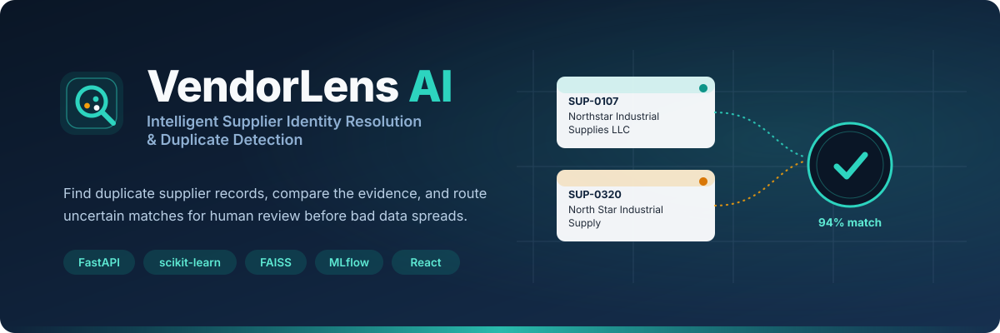
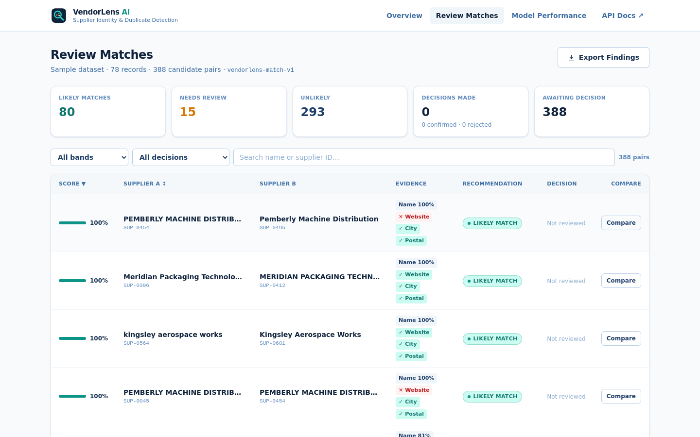
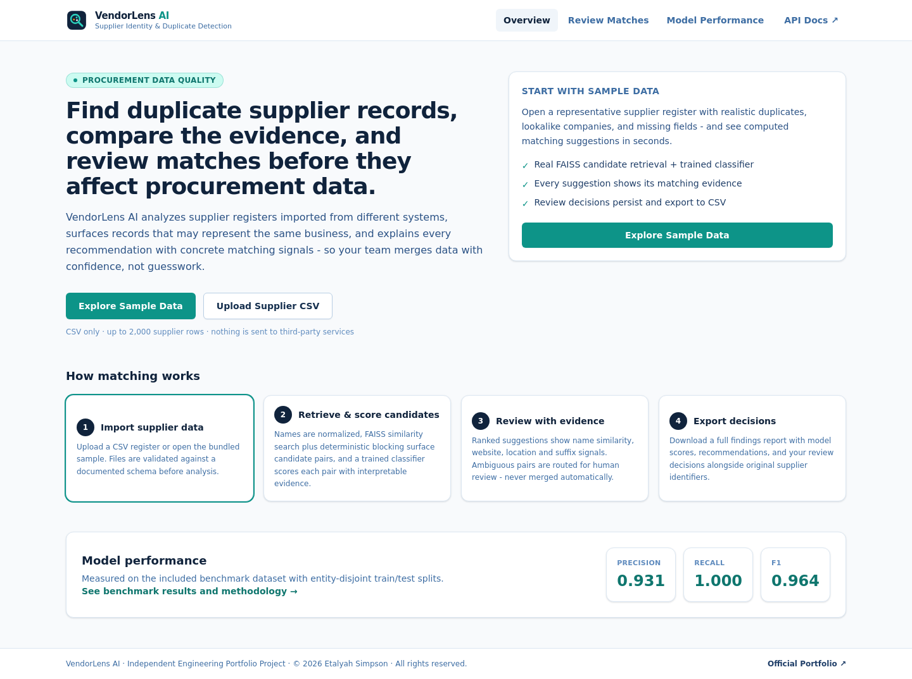
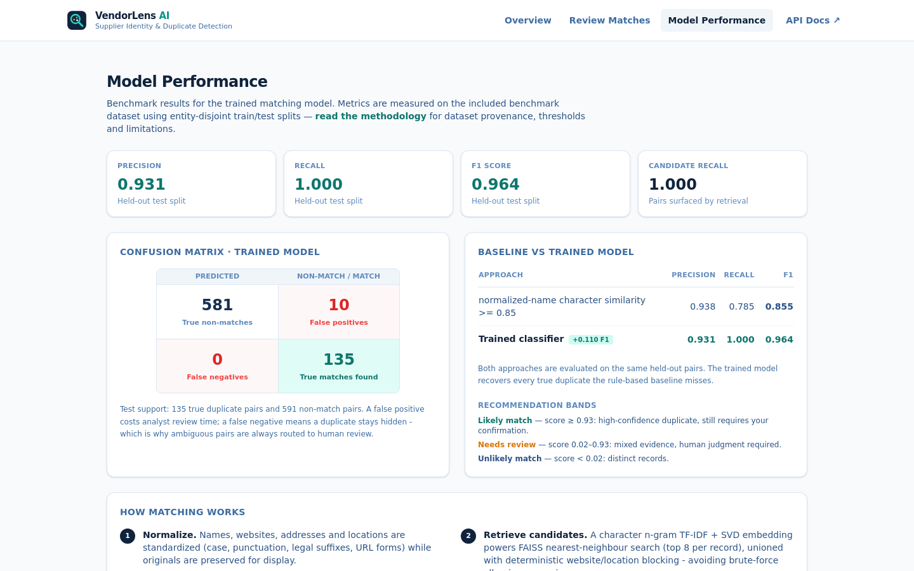
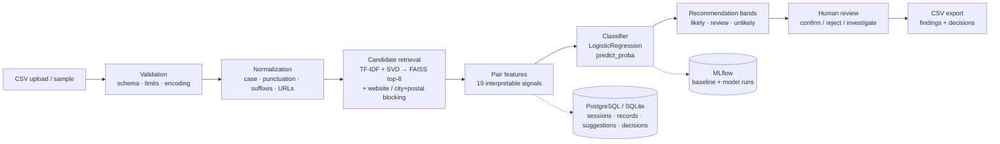

# VendorLens AI

**Find duplicate supplier records, compare the evidence, and review matches before they affect procurement data.**

VendorLens AI analyzes supplier registers imported from different systems, surfaces records that may represent the same business, and explains every recommendation with concrete matching signals — so procurement, finance and data-quality teams resolve duplicates with confidence instead of guesswork.

[](https://github.com/etalyahsimpson/vendorlens-ai/actions/workflows/ci.yml)


**[Demo screenshots](#-product-tour) · [Architecture](docs/ARCHITECTURE.md) · [ML evaluation](reports/model_evaluation.md) · [API docs](docs/API_REFERENCE.md) · [How to run](#-how-to-run)**



## The problem, the solution, the verified outcome

**The problem.** The same vendor reappears in supplier master data under abbreviations, punctuation variants, old addresses and inconsistent legal suffixes — while similar names often belong to *different* legal entities. Exact-string matching over-merges and under-finds; manual deduplication doesn't scale; and every silent duplicate leaks into spend analysis, payments and vendor risk.

**The solution.** A complete, local-first product: CSV validation → careful normalization → **FAISS** nearest-neighbour candidate retrieval + deterministic blocking → a **trained scikit-learn classifier** over 19 interpretable features → ranked suggestions with per-field evidence → **human review workflow** with persistent decisions → CSV export. Nothing merges automatically; every recommendation waits for a person.

**The verified outcome** (measured on the included benchmark dataset — [methodology](docs/ML_METHODOLOGY.md)):

| Approach (held-out test split, 44 unseen entities) | Precision | Recall | F1 |
|---|---:|---:|---:|
| Deterministic name-similarity baseline | 0.938 | 0.785 | 0.855 |
| **Trained classifier** | 0.931 | **1.000** | **0.964** |

The trained model recovers all 29 true duplicates the baseline misses, with 100% candidate-pair recall from retrieval. 82 backend tests, 9 Playwright end-to-end flows and Docker packaging are verified in CI on every push.

## Who it's for

Procurement teams, supply-chain operations analysts, finance data-quality teams, and any organization importing supplier registers from multiple systems.

## Product tour

| Overview & live analysis | Upload with real validation |
|---|---|
|  |  |

| Review workspace with evidence chips | Model performance |
|---|---|
|  |  |

- **Explore Sample Data** — one click opens a bundled 78-record supplier register (duplicate clusters, lookalike companies, namesakes, missing fields) and runs the full pipeline.
- **Upload Supplier CSV** — drag & drop with schema documentation, size/row limits, and precise validation errors (missing headers, duplicate IDs, encoding problems).
- **Review Matches** — ranked suggestions with score bars, evidence chips (name similarity, website domain, city, postal code, legal suffix), recommendation bands, filters and search, and an expandable side-by-side comparison drawer.
- **Decide with a human in the loop** — *Confirm same entity / Not the same entity / Needs investigation*, saved server-side and restored after reload.
- **Model Performance** — actual held-out metrics, confusion matrix, baseline comparison, thresholds and full feature definitions, with methodology links.
- **Export Findings** — CSV report with model scores, recommendations and your decisions, with spreadsheet-formula neutralization.

## How matching works



**ML design in one paragraph:** the benchmark register is generated deterministically (seed 42) with hard negatives and namesakes; splits are made **by canonical entity** so the model never sees a supplier's aliases in training; the TF-IDF/SVD name embedding is fitted on training data only; thresholds are selected on a validation split and frozen before the held-out test is scored; and the same normalization/feature code path runs at serving time, loading the versioned model bundle. Full details: [ML_METHODOLOGY.md](docs/ML_METHODOLOGY.md).

## Stack

| Layer | Technology | Where it lives |
|---|---|---|
| ML pipeline | Python, scikit-learn, NumPy | `backend/vendorlens/ml/` |
| Candidate retrieval | FAISS (`faiss-cpu`), TF-IDF + SVD | `backend/vendorlens/ml/candidates.py` |
| Experiment tracking | MLflow (local file store) | `backend/vendorlens/ml/training.py`, `./mlruns` |
| API | FastAPI, Pydantic | `backend/vendorlens/api/` |
| Persistence | SQLAlchemy, PostgreSQL / SQLite | `backend/vendorlens/db/` |
| Frontend | React 18, Vite, TypeScript, Tailwind CSS, Axios | `frontend/src/` |
| Tests | pytest (82), Playwright (9 e2e) | `backend/tests/`, `tests/e2e/` |
| Packaging | Docker, Docker Compose (PostgreSQL 16) | `backend/Dockerfile`, `docker-compose.yml` |
| CI | GitHub Actions | `.github/workflows/ci.yml` |

## How to run

### Docker Compose — full stack (PostgreSQL + API + web)

```bash
docker compose up --build
# Web app:      http://localhost:8080
# API + docs:   http://localhost:8000/docs
```

### Quick start — no Docker (SQLite + Vite)

```bash
# 1. Backend environment
python3 -m venv backend/.venv
backend/.venv/bin/pip install -e "backend[dev]"

# 2. Train the model (deterministic, ~30 seconds)
backend/.venv/bin/python backend/scripts/generate_dataset.py
backend/.venv/bin/python backend/scripts/train_model.py

# 3. API on :8000
backend/.venv/bin/python -m uvicorn vendorlens.api.app:app \
    --app-dir backend --host 127.0.0.1 --port 8000

# 4. Frontend on :5173 (separate terminal)
cd frontend && npm ci && npm run dev
```

### Reproduce the ML evaluation

```bash
make generate        # deterministic dataset (seed 42)
make train           # train + evaluate + MLflow runs + reports
make mlflow-ui       # inspect runs at http://localhost:5000
```

`reports/metrics.json` and `reports/model_evaluation.md` are regenerated from
scratch; the committed artifacts prove reproducibility rather than replacing it.

### Verify everything

```bash
make verify          # training + 82 tests + typecheck + build + Playwright e2e
```

## Security and data boundaries

- Local demonstration software: no authentication, bind to localhost; don't expose the API to the open internet.
- Uploads are untrusted data: CSV-only, ≤ 5 MB, ≤ 2,000 rows, UTF-8, control characters stripped, rendered as text (never HTML).
- Exports neutralize spreadsheet-formula payloads (`=`, `+`, `-`, `@`, leading tabs/CR) with a documented transformation.
- No third-party AI services, no telemetry, no data leaving the machine; all benchmark records are fictional (`.example` domains).
- No automatic merges — every consolidation requires an explicit human decision.

Details: [SECURITY_AND_LIMITATIONS.md](docs/SECURITY_AND_LIMITATIONS.md).

## Test results and CI

| Check | Command | Status |
|---|---|---|
| Backend suite (validation, FAISS, leakage, training, MLflow, API, export) | `make test` | CI-verified |
| PostgreSQL integration (real service) | `TEST_DATABASE_URL=postgres… pytest` | CI-verified |
| Frontend typecheck + production build | `make build` | CI-verified |
| Playwright browser flows + screenshots | `make e2e` | CI-verified |
| Docker images + compose health | `docker compose up --build` | CI-verified |

All jobs run on every push to `main` — the badge at the top reflects the latest commit.

## Documentation

- [Architecture](docs/ARCHITECTURE.md) — components, data path, failure modes
- [ML Methodology](docs/ML_METHODOLOGY.md) — dataset provenance, splits, features, thresholds, limitations
- [Model evaluation report](reports/model_evaluation.md) — generated from the measured run
- [Data dictionary](docs/DATA_DICTIONARY.md) — input schema, bands, signals, export columns
- [API reference](docs/API_REFERENCE.md) — endpoints with examples; OpenAPI at `/docs`
- [Engineering decisions](docs/ENGINEERING_DECISIONS.md) — why logistic regression, why FAISS, why human review
- [Project case study](docs/PROJECT_CASE_STUDY.md) — business problem → verified outcome
- [Skills evidence](docs/SKILLS_EVIDENCE.md) — every technology mapped to code and tests
- [Development log](docs/DEVELOPMENT_LOG.md) — factual build record
- [Portfolio integration](docs/PORTFOLIO_INTEGRATION.md) — card art and copy for the reserved portfolio root
- [Security & limitations](docs/SECURITY_AND_LIMITATIONS.md)

## About this project

VendorLens AI is an **independent machine-learning engineering portfolio
project** by Etalyah Simpson ([Official Portfolio](https://etalyahsimpson.github.io/)).
It is not affiliated with any employer, and the supplier records are synthetic,
deterministically generated fixtures — not customer data. The term
"VendorLens" is a working project title, not a trademark claim.

**Roadmap (realistic next steps):** gradient-boosted or embedding-based
scoring behind the same evidence contract · ANN indexes (IVF/HNSW) and
phonetic blocking for larger registers · authentication, audit logging and
role separation for multi-user deployments · evaluation on anonymized
real-world registers with band recalibration.
